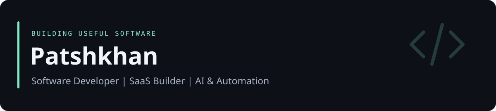

## About Me

I'm **Patshkhan**, a software developer building web products and practical tools. My current work spans SaaS, full-stack applications, AI integrations, and a Linux-based development workflow.

I'm interested in IT and AI hackathons where a working prototype, clear product thinking, and a useful outcome matter.

**Focus:** Full-stack Web Development · AI & Automation · SaaS Products · Linux & DevOps · PostgreSQL & Backend · Docker & Deployment

## Tech Stack

| Area | Technologies used in my projects |
| --- | --- |
| Web | JavaScript, TypeScript, React, Next.js, HTML, CSS |
| Backend & data | Node.js, NestJS, PostgreSQL, Drizzle ORM |
| Mobile | Flutter, Dart |
| AI & automation | API integrations, server-side AI workflows, shell scripting |
| Environment & delivery | Arch Linux, Git, GitHub CLI, Docker, Docker Compose |
| Testing | Node.js tests, Playwright, PGlite |

## Featured Projects

### [TenderMatch → Product showcase](https://github.com/Patshkhan/tendermatch-showcase)

A SaaS workspace for finding and reviewing Kazakhstan procurement opportunities. Monitoring topics, matching, filters, favorites, notes, and optional AI assistance. **Working MVP; active development.**

| Project | What I'm building | Source |
| --- | --- | --- |
| **MIRLAN Coffee** | An interactive coffee website with motion, responsive scenes, and a digital menu. Next.js, TypeScript, GSAP. | Private |
| **Жолда / JOLDA** | A mobility project for local and inter-settlement trips in Kazakhstan. Flutter app, NestJS API, Next.js management interface. MVP development and pilot preparation. | Private |
| **Aveniqo / College OS** | An education platform with assignments, attendance, student documents, and institution-level access boundaries. Next.js, TypeScript, PostgreSQL. Pilot preparation. | Private |

These are existing projects. Private repositories are described here without access-restricted links or customer information.

## What I'm Building

- Improving TenderMatch's monitoring and tender-review workflows.
- Developing JOLDA's passenger and driver experience.
- Continuing Aveniqo's education workflows and institution separation.
- Refining interactive web interfaces through the coffee website.

## Learning & Development

I document useful commands and build small examples alongside product work:

- [Arch Linux Notes](https://github.com/Patshkhan/arch-linux-notes) — pacman, systemd, logs, NVIDIA diagnostics, and GitHub CLI.
- [Docker Lab](https://github.com/Patshkhan/docker-lab) — an original learning service with Compose and HTTP tests.
- [Linux Dev Setup](https://github.com/Patshkhan/linux-dev-setup) — an inspectable starting point for a development environment.

These are growing learning repositories. My next areas of focus are deployment reliability, database boundaries, testing, and useful AI integrations.

## Contact

Open to hackathon teams and conversations about SaaS, AI, and automation. Reach me through a [public collaboration issue](https://github.com/Patshkhan/tendermatch-showcase/issues/new) or [my GitHub profile](https://github.com/Patshkhan).

**По-русски:** разрабатываю веб-продукты, SaaS и инструменты автоматизации. Открыт к участию в IT/AI-хакатонах. Публичные материалы показывают реальные проекты; коммерческие исходники остаются закрытыми.
